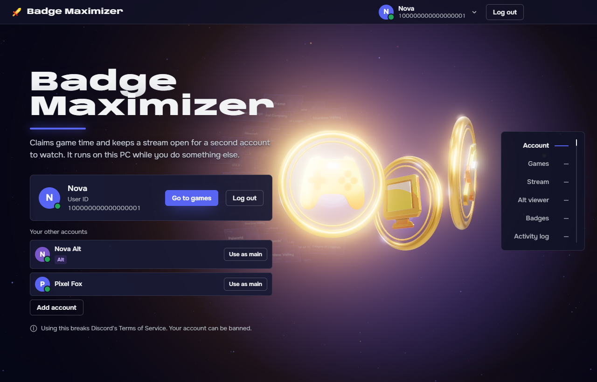
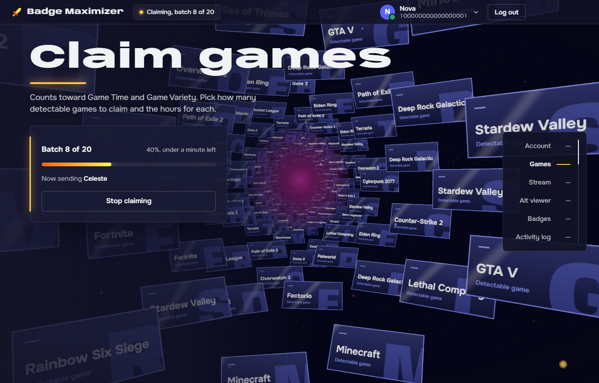
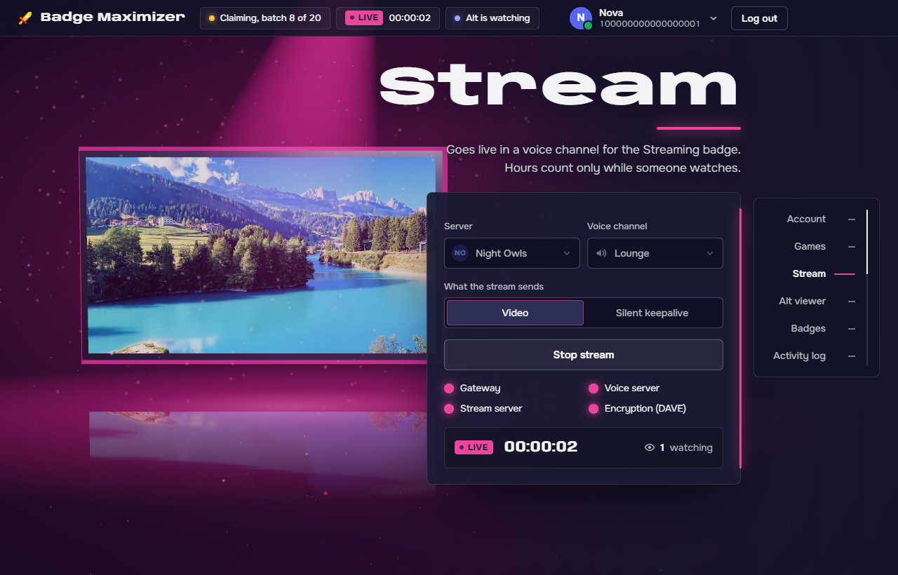
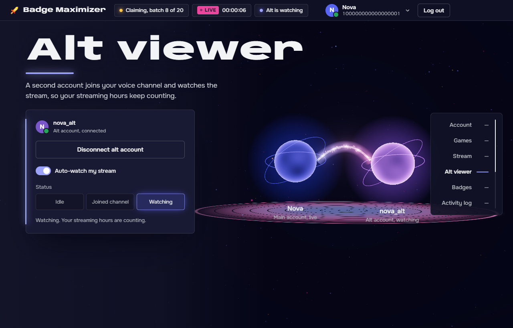
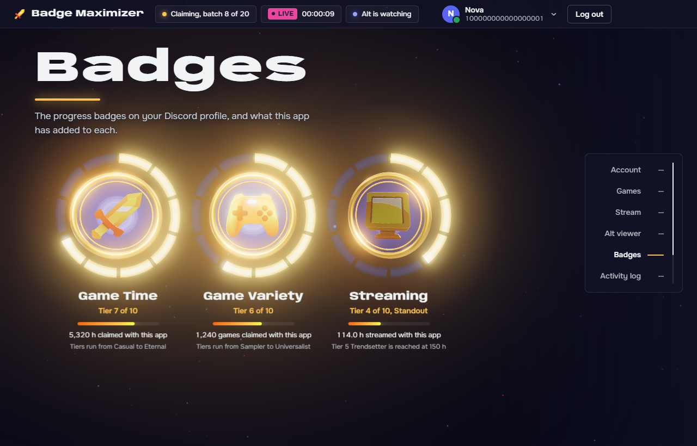
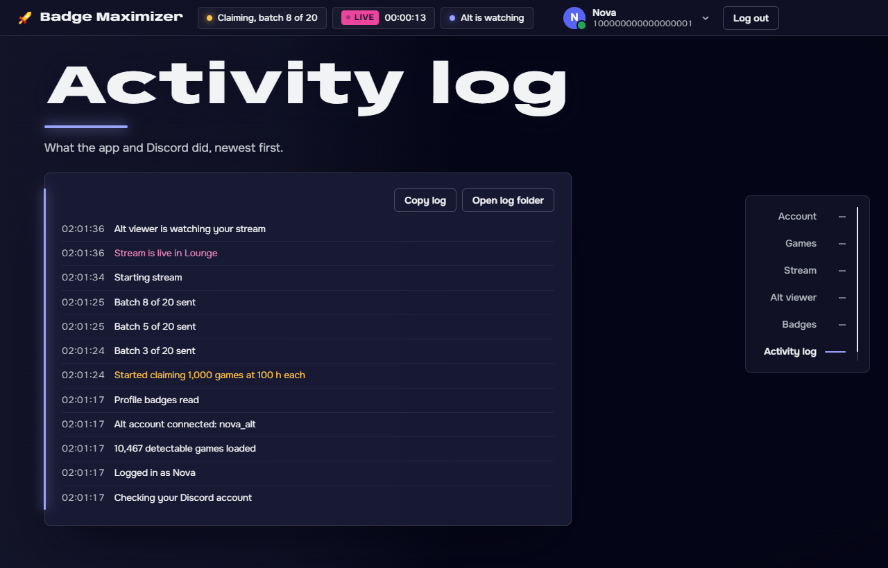

# Badge Maximizer for Discord, as a desktop app

A Windows app for Discord's Game Time, Game Variety and Streaming profile badges. It puts an interface, saved logins and an installer around the scripts from [sonuworks/discord-badge-maximizer](https://github.com/sonuworks/discord-badge-maximizer), which do the actual work against Discord.



> **Using this breaks Discord's Terms of Service.** Discord can restrict or ban accounts for automation, and [issue #5](https://github.com/sonuworks/discord-badge-maximizer/issues/5) on the original repo reports a login that was invalidated on first use. Only use an account you can afford to lose. This project has no connection to Discord.

## Download

Get `badge-maximizer-0.1.0-setup.exe` from the [latest release](https://github.com/Yarouki/discord-badge-maximizer-desktop/releases/latest). It runs on Windows 10 and 11 (64-bit), needs no admin rights, and brings everything with it. You don't have to install Python or FFmpeg.

The installer isn't code-signed, so Windows shows "Windows protected your PC" the first time. Click "More info", then "Run anyway". Some antivirus programs flag the backend because it is a compiled Python program. If you'd rather not trust a download, build it yourself from this source (see below).

## What it does

### Claim games

Pick how many detectable games to claim and how many hours each one gets. The app sends them in batches and shows the batch it is on, the game it is sending and the time left.



### Stream

Pick a server and a voice channel and go live. The stream sends either a video clip or a silent keepalive, and you can switch between the two while live. The panel shows each connection step, the time on air and how many people are watching.



### Alt viewer

Discord only counts streaming hours while someone watches. A second account of yours joins the voice channel and watches the stream by itself, so the hours keep counting.



### Badges

Shows the tier of each badge on your profile and what this app has added to it.



### Activity log

Every step the app and Discord took, newest first, with a button to copy it and one to open the log file's folder.



## What this version adds to the original scripts

- A desktop interface in place of the console menus, with a 3D scene for each section. On a PC without a graphics card it shows a plain layout instead, so it stays light in a VM or over remote desktop.
- Login happens in Discord's own login window. There is no token or cookie to copy by hand.
- Several accounts can be saved. One is the main, one can be the alt viewer, and you switch between them from a menu.
- Saved logins are encrypted with Windows data protection (DPAPI) and can only be read by your Windows user. The interface never receives a token, and the log file has tokens removed.
- Claims retry a failed batch three times, count what failed and say what was really sent. A game is only marked as used after Discord accepted it.
- Streams watch their own connections. A dead voice or stream connection is rebuilt up to three times, and a stream that can't be saved ends with a plain reason.
- Streamed hours are saved every minute, so a crash doesn't lose an overnight stream. The PC is kept awake while a stream is live.
- If FFmpeg or the video is missing, the stream falls back to the silent keepalive and says so.
- The activity log is also written to a file (rotated at 1 MB) at `%APPDATA%\Badge Maximizer\logs`.
- Only one copy of the app runs at a time, and closing it stops the backend and FFmpeg with it.
- One installer holds the app, the compiled backend and FFmpeg. The uninstaller asks whether to delete your saved logins and totals.

## Where your data is

Saved logins, totals and the log are in `%APPDATA%\Badge Maximizer`. Nothing is sent anywhere except to Discord. Logins are tied to the Windows user they were saved under, so copying the folder to another PC doesn't carry them over.

## Build from source

You need Windows, Node.js 22, Python 3.11, the Visual Studio 2022 C++ build tools and PowerShell 7.

Install the Python packages:

```powershell
py -3.11 -m pip install nuitka -r scripts/requirements.txt
```

Put a 64-bit Windows `ffmpeg.exe` into `app\resources-ffmpeg\` (the release uses the full build from [gyan.dev](https://www.gyan.dev/ffmpeg/builds/)). Then build the backend and the installer:

```powershell
cd app
npm ci
npm run build:backend
npm run build:win
```

The installer ends up in `app\dist`. To run the app without building an installer, use `npm run dev`. It starts the Python scripts directly.

## Credits

- `scripts/games.py` and `scripts/stream.py` are by [Sonu Jana](https://github.com/sonuworks) and come from [discord-badge-maximizer](https://github.com/sonuworks/discord-badge-maximizer) v1.3.0. Comments are removed, the code is unchanged.
- [FFmpeg](https://ffmpeg.org) is a separate program under the GPL v3. Its license and build details are in `app/resources-ffmpeg`.
- The fonts are Anybody and Onest, both under the SIL Open Font License.
- Built with [Electron](https://www.electronjs.org) and [three.js](https://threejs.org).

## License

MIT. See [LICENSE](LICENSE).
